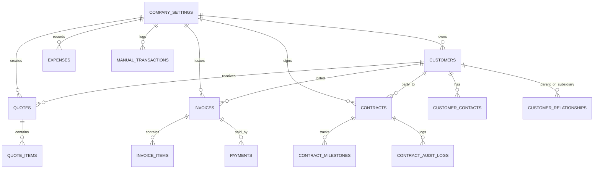

# System Design & Architecture Document
## Modular Multi-Client Enterprise CRM Template

**Architecture Version**: `1.0.0`  
**Frontend Stack**: React 18 / TypeScript 5 / Vite 5 / Tailwind CSS 3 / Lucide Icons / jsPDF  
**Backend & Persistence Target**: Supabase (PostgreSQL with RLS) + Reactive In-Browser Mock Store  

---

## 1. High-Level Architecture Overview

```
+---------------------------------------------------------------------------------------+
|                                    PRESENTATION LAYER                                 |
|                                                                                       |
|   +-----------------------+   +----------------------+   +------------------------+   |
|   | SimpleAdminDashboard  |   |   Customer360Hub     |   |    QuoteManagement     |   |
|   +-----------------------+   +----------------------+   +------------------------+   |
|   +-----------------------+   +----------------------+   +------------------------+   |
|   |   InvoiceManagement   |   |  ContractManagement  |   |   FinanceManagement    |   |
|   +-----------------------+   +----------------------+   +------------------------+   |
+---------------------------------------------------------------------------------------+
                                           |
                                           v
+---------------------------------------------------------------------------------------+
|                                 CONTEXT & STATE LAYER                                 |
|                                                                                       |
|   +---------------------+   +-----------------------+   +-------------------------+   |
|   |   CompanyContext    |   | ActionProgressContext |   |      ToastProvider      |   |
|   | (Tenant/Client St.) |   |   (Async Pill Modal)  |   |   (Action Notifications)|   |
|   +---------------------+   +-----------------------+   +-------------------------+   |
+---------------------------------------------------------------------------------------+
                                           |
                                           v
+---------------------------------------------------------------------------------------+
|                                     SERVICE LAYER                                     |
|                                                                                       |
|   customerService  |  quoteService  |  invoiceService  |  contractService             |
|   financeService   |  expenseService|  rateCardService |  paymentService              |
+---------------------------------------------------------------------------------------+
                                           |
                    +----------------------+----------------------+
                    |                                             |
                    v (VITE_USE_MOCK === 'true')                  v (Supabase Configured)
+---------------------------------------+     +-----------------------------------------+
|           MOCK STORAGE ENGINE         |     |          SUPABASE POSTGRESQL            |
|                                       |     |                                         |
|  * In-Memory + localStorage sync      |     |  * PostgreSQL Tables & Foreign Keys     |
|  * Relational join emulation          |     |  * Row-Level Security (Tenant Isolation)|
|  * Automatic sequence generation      |     |  * Realtime Subscriptions & Triggers    |
|  * Instant seed data & reset capability|     |  * Auto-generated REST & RPC API       |
+---------------------------------------+     +-----------------------------------------+
```

---

## 2. White-Label & Client Customization Blueprint

When copying this CRM repository for a new client, developers only need to configure:

### Step 1: Client Metadata & Feature Flags
Edit `src/config/client.config.ts`:
```typescript
export const clientConfig = {
  clientId: 'client-acme-technologies',
  clientName: 'Acme Technologies Inc.',
  legalEntityName: 'Acme Technologies Worldwide LLC',
  logoUrl: '/brand/client-logo.svg',
  faviconUrl: '/brand/favicon.ico',
  branding: {
    primaryColor: '#2563EB',     // Tailwind blue-600
    primaryHover: '#1D4ED8',     // Tailwind blue-700
    accentColor: '#10B981',      // Tailwind emerald-500
    sidebarBg: '#0F172A',        // Slate-900
    sidebarText: '#F8FAFC',
  },
  defaultCurrency: 'USD',
  taxSystem: 'SALES_TAX',        // 'GST' | 'VAT' | 'SALES_TAX'
  activeModules: {
    customers: true,
    quotes: true,
    invoices: true,
    contracts: true,
    finance: true,
    expenses: true,
    income: true,
  }
};
```

### Step 2: Set Environment Variables
In `.env`:
```env
VITE_USE_MOCK=true
# When ready for Supabase:
# VITE_USE_MOCK=false
# VITE_SUPABASE_URL=https://your-project.supabase.co
# VITE_SUPABASE_ANON_KEY=your-anon-key
```

### Step 3: Run SQL Migration in Supabase
When promoting to production, execute `supabase/migrations/001_initial_crm_schema.sql` inside the Supabase SQL Editor.

---

## 3. UI/UX Design System & Tokens

### Color Semantics
- **Brand Primary**: Royal Indigo (`indigo-600` / `#4F46E5`) & Electric Blue (`blue-600` / `#2563EB`)
- **Success / Paid / Accepted**: Emerald (`emerald-600` / `#059669`)
- **Warning / Pending / Draft**: Amber / Orange (`amber-500` / `#F59E0B`)
- **Danger / Overdue / Rejected**: Rose / Crimson (`red-600` / `#DC2626`)
- **Neutral Dark (Sidebar & Modals)**: Slate (`slate-900` / `#0F172A`)
- **Surface & Cards**: Pure White (`#FFFFFF`) with border (`slate-200` / `#E2E8F0`)

### Typography
- Headings: Inter / System Font, Semi-Bold (`font-semibold`) and Bold (`font-bold`)
- Numbers & Currency: Tabular figures (`tabular-nums font-mono` or structured formatters)
- Badges: `px-2.5 py-0.5 rounded-full text-xs font-medium`

---

## 4. Component Hierarchy & Navigation

```
<App>
  <ToastProvider>
    <ActionProgressProvider>
      <CompanyProvider>
        <SimpleAdminDashboard>
          |-- <Sidebar> (Module selection, Collapsible sections, Client branding)
          |-- <Header> (Company entity selector, Currency indicator, User avatar)
          |-- <MainContentArea>
                |-- (view === 'dashboard')   => <DashboardOverviewCards>, <RecentInvoices>, <ActivityStream>
                |-- (view === 'customers')   => <CustomerManagement> (modals: <CustomerContactModal>)
                |-- (view === 'customer-360')=> <Customer360Hub> (sub-tabs: Quotes, Invoices, Contracts, Hierarchy)
                |-- (view === 'quotes')      => <QuoteManagement> (modals: <CreateQuote>, <QuoteRateCardSelector>)
                |-- (view === 'invoices')    => <InvoiceManagement> (modals: <CreateInvoice>, <EditInvoice>)
                |-- (view === 'contracts')   => <ContractManagement> (modals: <CreateContractModal>, <ViewContractModal>, <StatusUpdateModal>, <ContractTemplateManagement>)
                |-- (view === 'income')      => <IncomeManagement>
                |-- (view === 'expenses')    => <ExpenseManagement>
                |-- (view === 'finance')     => <FinanceManagement>
```

---

## 5. Supabase PostgreSQL Schema Design



### Table Definitions Summary:
1. `countries`: Master country directory, currency symbols, VAT/GST flags.
2. `company_settings`: Multi-entity client configurations (India, Ireland, US, UK, UAE).
3. `customers`: Core account entities, tax IDs, credit limits, relationship managers.
4. `customer_contacts`: Multiple stakeholders per account with decision-maker flags.
5. `customer_relationships`: Hierarchical corporate links (parent/child/subsidiary).
6. `rate_card_templates`: Billable rates across disciplines (Senior Architect, Tech Lead, etc.).
7. `quotes` & `quote_items`: Configured proposals with conversion status.
8. `invoices` & `invoice_items`: Formal billing ledger with tax breakdowns.
9. `payments`: Payment transactions linked to invoices.
10. `contracts`, `contract_sections`, `contract_milestones`, `contract_audit_logs`: CLM system.
11. `contract_templates`: Reusable contractual boilerplate documents.
12. `income_categories` & `manual_transactions`: Operating revenue stream ledger.
13. `expense_categories`, `vendors`, & `expenses`: Operating expenditure management.

---

## 6. Service Layer Dual-Mode Pattern

Every service (e.g. `customer360Service`, `quoteService`, `invoiceService`, `contractService`, `financeService`) implements an adaptive persistence interface:

```typescript
export class DataService {
  private static useMock(): boolean {
    return !isSupabaseConfigured || import.meta.env.VITE_USE_MOCK === 'true';
  }

  async getAll(): Promise<Entity[]> {
    if (DataService.useMock()) {
      return mockStore.getAll<Entity>('entities');
    }
    const { data, error } = await supabase.from('entities').select('*');
    if (error) throw error;
    return data;
  }
}
```
This guarantees zero disruption during client prototyping while maintaining direct Supabase compatibility.

